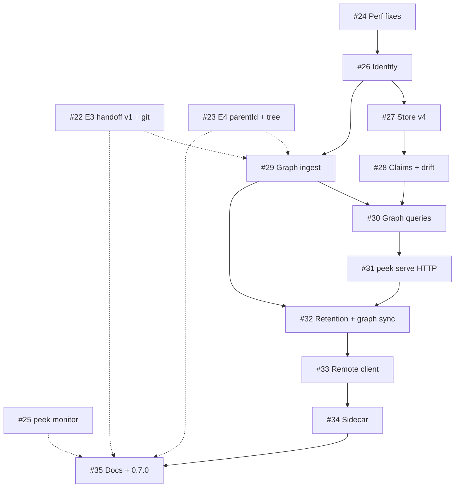

# agent-peek 0.7: remaining work

The 0.7 work that hadn't merged when the design record was exported on 2026-11-17. Each row is a GitHub issue in milestone [`0.7.0`](https://github.com/akhileshrangani4/agent-peek/milestone/1) with the label `0.7`; the issue holds the scope, acceptance criteria, tests, planned commits and suggested branch. The spec is [`spec-0.7.md`](spec-0.7.md).

Already merged into `release/0.7.0` (release PR #13): #14 export guard (D1), #15 adapter fixes (D3.6, D3.7), #16 golden parity harness (D3.1 baseline), #17 OpenCode V2 adapter (D8.1), #18 handoff signal and goal (D9.3, D9.4), #19 service layer and MCP registry (D3.1, D3.2, D3.8), #20 per-call paths and file roles (D9.1, D9.2). Their test transcripts are in [`qa-evidence/`](qa-evidence/README.md).

Every PR for these issues targets `release/0.7.0`, not `main`.

| Issue | Title | Spec IDs | Depends on | Status |
|---|---|---|---|---|
| [#22](https://github.com/akhileshrangani4/agent-peek/issues/22) | E3 · Handoff JSON v1 schema and git artifacts (D9.5, D9.6, D9.7; issues #4, #3) | D9.5, D9.6, D9.7 | none | not started (stopped mid-work earlier; no branch pushed) |
| [#23](https://github.com/akhileshrangani4/agent-peek/issues/23) | E4 · Prefixed parentId, check --ignore-self fix and peek tree (D9.8, D9.9; issue #5) | D9.8, D9.9 | none | not started (stopped mid-work earlier; no branch pushed) |
| [#24](https://github.com/akhileshrangani4/agent-peek/issues/24) | Coordination and registry performance fixes (D3.3, D3.4, D3.5) | D3.3, D3.4, D3.5 | none | not started (stopped mid-work earlier; no branch pushed) |
| [#25](https://github.com/akhileshrangani4/agent-peek/issues/25) | peek monitor: opt-in OpenCode failure monitor with gated retry (D8.2–D8.8, D8.10) | D8.2–D8.8, D8.10 (D8.9 is a QA live probe) | none | not started (stopped mid-work earlier; no branch pushed) |
| [#26](https://github.com/akhileshrangani4/agent-peek/issues/26) | Portable project, machine and session identity (D2.1, D2.7) | D2.1, D2.7 | [#24](https://github.com/akhileshrangani4/agent-peek/issues/24) | not started |
| [#27](https://github.com/akhileshrangani4/agent-peek/issues/27) | Per-project store v4, seq cursors and cursor guards (D2.2, D2.3, D2.4) | D2.2, D2.3, D2.4 | [#26](https://github.com/akhileshrangani4/agent-peek/issues/26) | not started |
| [#28](https://github.com/akhileshrangani4/agent-peek/issues/28) | Claims into the project store and content-hash drift (D2.5, D2.6) | D2.5, D2.6 | [#27](https://github.com/akhileshrangani4/agent-peek/issues/27) | not started |
| [#29](https://github.com/akhileshrangani4/agent-peek/issues/29) | Local knowledge graph: schema and incremental ingestion (D4.1, D4.2, D4.5, D4.7) | D4.1, D4.2, D4.5, D4.7 | [#26](https://github.com/akhileshrangani4/agent-peek/issues/26); merge first: [#22](https://github.com/akhileshrangani4/agent-peek/issues/22), [#23](https://github.com/akhileshrangani4/agent-peek/issues/23) | not started |
| [#30](https://github.com/akhileshrangani4/agent-peek/issues/30) | Graph queries, CLI/MCP surface and graph-proximity ranking (D4.3, D4.4, D4.6) | D4.3, D4.4, D4.6 | [#29](https://github.com/akhileshrangani4/agent-peek/issues/29), [#28](https://github.com/akhileshrangani4/agent-peek/issues/28) | not started |
| [#31](https://github.com/akhileshrangani4/agent-peek/issues/31) | peek serve: Streamable HTTP MCP, REST, auth, limits and Docker (D5.1–D5.5, D5.8) | D5.1–D5.5, D5.8 | [#30](https://github.com/akhileshrangani4/agent-peek/issues/30) | not started |
| [#32](https://github.com/akhileshrangani4/agent-peek/issues/32) | peek serve: retention job, project deletion and graph sync (D5.6, D5.7) | D5.6, D5.7 | [#31](https://github.com/akhileshrangani4/agent-peek/issues/31), [#29](https://github.com/akhileshrangani4/agent-peek/issues/29) | not started |
| [#33](https://github.com/akhileshrangani4/agent-peek/issues/33) | Remote client, offline outbox and peek push (D6.1, D6.2, D6.3, D6.6) | D6.1, D6.2, D6.3 (push half), D6.6 | [#32](https://github.com/akhileshrangani4/agent-peek/issues/32) | not started |
| [#34](https://github.com/akhileshrangani4/agent-peek/issues/34) | peek agent sidecar, vendor snippets and agent instructions (D6.3, D6.4, D6.5, D7.5) | D6.3 (agent half), D6.4, D6.5, D7.5 | [#33](https://github.com/akhileshrangani4/agent-peek/issues/33) | not started |
| [#35](https://github.com/akhileshrangani4/agent-peek/issues/35) | Docs, 0.6→0.7 upgrade test, CHANGELOG and 0.7.0 version (D7.1–D7.4) | D7.1–D7.4, D9.11 | [#34](https://github.com/akhileshrangani4/agent-peek/issues/34); merge first: [#25](https://github.com/akhileshrangani4/agent-peek/issues/25), [#22](https://github.com/akhileshrangani4/agent-peek/issues/22), [#23](https://github.com/akhileshrangani4/agent-peek/issues/23) | not started |

Four issues (#22, #23, #24, #25) were picked up before the export and stopped part-way. Their workers pushed no branches, so each starts fresh from `origin/release/0.7.0`.

## Dependency graph

Solid arrows are hard dependencies (the issue's "Depends on"). Dotted arrows are the "merge first" ordering checks.

## Other follow-ups

Two items PR #17 (OpenCode V2 adapter) flagged and kept out of its scope. They are tracked here only, not as issues.

- **Possibly flaky `peek coord` golden.** The existing `peek coord` golden failed once in one full local run, then passed in about 10 later runs and in CI. The diff wasn't captured, so the cause is unknown; it may be load-sensitive timing. Before release, loop the golden suite (for example 20 full runs) and capture any diff. If it reproduces, fix it in its own PR.
- **Outdated Goose row in `peek doctor`.** The Goose row still says `sqlite3 required`, although #15 moved Goose to `node:sqlite`. Fixing it rewrites an existing golden line, which the additive-only rule forbids, so it needs the owner's sign-off or a decision under the golden policy (D9.10). Settle it in the D9 work or in the docs/release issue ([#35](https://github.com/akhileshrangani4/agent-peek/issues/35)).
