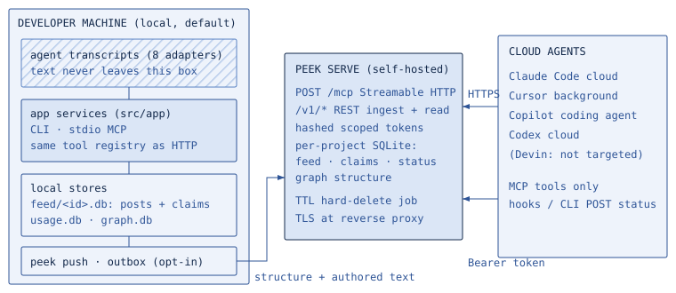

*Spec · agent-peek 0.7 · akhileshrangani4/agent-peek @ main b6197fe*

# agent-peek 0.7: off localhost, across cloud agents, with a conversation knowledge graph

Make agent-peek's identities portable, clean up the core, add a local knowledge graph, and ship an opt-in self-hostable `peek serve` that Claude Code cloud, Cursor, Copilot and Codex cloud agents can reach — while local stdio use stays exactly as it is today.

**Contents**

- [Decision to approve](#decision-to-approve)
- [What I read and what it changed](#what-i-read-and-what-it-changed)
- [What we should build](#what-we-should-build)
- [D1 · Retention and trust boundary (ADR 0002)](#d1--retention-and-trust-boundary-adr-0002)
- [D2 · Portable identity and per-project coordination store](#d2--portable-identity-and-per-project-coordination-store)
- [D3 · Core overhaul: service layer, adapters, performance](#d3--core-overhaul-service-layer-adapters-performance)
- [D4 · Local conversation knowledge graph](#d4--local-conversation-knowledge-graph)
- [D5 · `peek serve`: remote MCP, ingest API, tokens](#d5--peek-serve-remote-mcp-ingest-api-tokens)
- [D6 · Remote clients, ingestion and cloud-agent setup](#d6--remote-clients-ingestion-and-cloud-agent-setup)
- [D7 · Docs, agent instructions, migration and 0.7.0 release](#d7--docs-agent-instructions-migration-and-070-release)
- [D8 · OpenCode V2 adapter and the `peek monitor` retry monitor](#d8--opencode-v2-adapter-and-the-peek-monitor-retry-monitor)
- [D9 · Handoff and multi-agent accuracy (issues \#1–#7)](#d9--handoff-and-multi-agent-accuracy-issues-17)
- [Compatibility guarantees and how they are tested](#compatibility-guarantees-and-how-they-are-tested)
- [Delivery, locked decisions and risks](#delivery-locked-decisions-and-risks)

## Decision to approve

agent-peek only works on one machine: it reads transcripts from local disk, keeps every store under `~/.agent-peek`, and serves MCP over stdio only. This spec ships 0.7.0 on a release branch. It fixes identity so data from several machines can merge, cleans up the core, adds a local knowledge graph, and adds an opt-in, self-hosted `peek serve` that four cloud agent products can reach.

**Approve or challenge these five choices.** You confirmed all five on 2026-11-13. Each one decides the shape of a deliverable:

1.  **Scope:** everything through the server and ingestion, on one release branch. That covers D1–D7 below. LLM fact extraction, embeddings, OAuth, vendor pull connectors and multi-tenant hosting are out of scope.
2.  **Hosting:** a self-hostable `peek serve` (a single Node process or Docker image, backed by SQLite). Nobody operates a shared service.
3.  **Retention:** machines and the server exchange only structure, whitelisted fields, and short text that people or agents authored or derived. Transcript text never leaves the machine. A local text index is opt-in.
4.  **Remote-less repos:** a user can assign a project key in a committed file or an env var. Without one, the repo stays machine-local.
5.  **Compatibility:** the exported library storage API may break in 0.7.0, with a migration note. CLI commands, MCP tool names and on-disk data stay compatible.

**Launch agents:** Claude Code (cloud/web), Cursor background agents, the GitHub Copilot coding agent and Codex cloud. Devin is not a launch target, but nothing in the design excludes it.

> **Ref: Load-bearing assumption**
>
> This build assumes two things. First, the four cloud products can be pointed at a `peek serve` endpoint. Second, once connected, agents actually read and post to the shared feed, so duplicate exploration and conflicting edits drop.
>
> - **What confirms or breaks it.** D6 ships a per-vendor setup doc and an automated conformance test for each product's documented MCP config shape. That proves the server speaks each product's protocol, not that the vendor's cloud runs it. A live two-product pilot follows the release: Claude Code cloud plus Cursor, counting unprompted `read_feed`/`post_to_feed` calls. If agents rarely call the tools, the bottleneck is instructions and hooks, not transport.
> - **Codex cloud.** Whether Codex cloud tasks can use remote MCP was *not verified* (research B §7). Its setup doc must cover a CLI-over-HTTPS fallback.
> - **Explanations the brief skipped.** Git branches and PR comments may already coordinate cloud agents working on isolated clones. Vendors already expose some visibility (Cursor Cloud MCP, Devin's message API). The real gap may be one human seeing every agent, not agents talking to each other. For the graph, which facts are stored and how long they are kept matters more than which database holds them.

> **Ref: Out of scope (non-goals)**
>
> The following are out of scope:
>
> - LLM-inferred graph edges (`DECIDED` by model, `MENTIONS_ENTITY`) and embedding similarity
> - OAuth 2.1 and Protected Resource Metadata
> - Devin and Cursor pull connectors
> - A multi-tenant hosted service, Postgres or pgvector
> - A dedicated graph database
> - Sending transcript text to the server
> - A server-side handoff runner
> - A web dashboard

## What I read and what it changed

The evidence comes from three read-only research passes against `main@b6197fe`, consolidated in [research-overview.md](research-overview.md). File and line references below are restated from Research A ([research-a-codebase-map.md](research-a-codebase-map.md)), B ([research-b-cloud-architecture.md](research-b-cloud-architecture.md)) and C ([research-c-graph-db.md](research-c-graph-db.md)).

| I read | What I learned | What it changed in this spec |
|----|----|----|
| `src/core/types.ts:7-30`, `registry.ts:39-147` | Sessions are keyed by adapter id plus a local `transcriptPath`. The registry is JSON, and `Engine.list()` rewrites it under a lock on every read. | D2 adds a machine-namespaced global session id. D3 makes reads stop writing. |
| `core/claims.ts:22-136`, `cli/index.ts:1269-1283` | Claims live in one global `claims.json` with absolute paths. Path normalisation lives in the CLI. `claims.ts` has 4.41% line coverage. | D2 moves claims into per-project SQLite with repo-relative paths, plus a one-time import. D3 moves the path rules into a service. |
| `feed/store.ts:19-155`, `feed/identity.ts:13-53` | The feed DB has no schema version and only the `posts_created` and `post_paths_path` indexes. The feed cursor tracks the writer's `createdAt`. Project identity hashes the normalised origin and otherwise falls back to machine-local paths. Authors fall back to `user@hostname`. | D2 adds versioned migrations, a server-assigned `seq` cursor, the project-key precedence, and a split between principal and label. |
| `usage/schema.ts:85-147`, `usage/store.ts:115-150`, ADR 0001 | The usage index already has watermarks, deterministic primary keys, per-source transactions and additive-only migrations. ADR 0001 forbids storing raw tool input. | D4 reuses this pattern and the watermarks for graph ingestion. D1 writes ADR 0002 to extend ADR 0001's retention rule to the graph and the network. |
| Adapters: `claude-code/index.ts:22-96`, `codex/parse.ts:52-68`, `goose/index.ts:76-77`, `adapters/sqlite.ts:12-16` | JSONL slicing is duplicated. Codex drops `call_id`. Adapters ignore `CLAUDE_CONFIG_DIR`/`CODEX_HOME`. Goose shells out to the `sqlite3` CLI with SQL built by string interpolation. | D3 delivers a shared JSONL reader, keeps Codex `call_id`, applies env roots everywhere, and reads Goose through `node:sqlite`. |
| `core/coordination.ts`, `feed/derive.ts:27-92` | Coordination re-reads a changed session from byte 0 after a delta read. Derived status posts call `list()` and then `peek()` once per session (an N+1 pattern, inferred). | D3 sets performance acceptance criteria with read counts that a test asserts. |
| `src/index.ts:4-130`, `package.json:8-33` | Storage classes and path helpers are public exports. `./adapter` is a plugin interface for third-party adapters. | The compatibility section lists what stays stable and what breaks, with the migration note. |
| `mcp/index.ts:27-222`, `:548-549` | The MCP server runs on stdio only and exposes 12 tools, 3 prompts and resources. Tool defaults use the server's `process.cwd()`. `peek_session` defaults to `mode: raw`. | D5 shares tool definitions between stdio and HTTP. The remote tool set requires a project and drops the raw, tail and handoff modes. |
| Vendor docs, retrieved 2026-11-13 (B §2.1) | Streamable HTTP is the transport all of them share, and every product accepts a bearer header. Copilot cannot use OAuth servers and ignores resources and prompts. Cursor proxies MCP through its backend, so the server needs public TLS. Codex cloud remote MCP is unverified. | D5 is HTTP-only, uses bearer tokens, and exposes everything as tools. D6 writes vendor docs that name the egress allowlist step. |
| Graph store survey (C §3); `node:sqlite` probe on Node 24.22.3 | FTS5, recursive CTEs and JSON functions work. Every target query needs at most 2 hops, except the subagent tree. Kùzu was archived in Oct 2025. FalkorDB is SSPL. Neo4j Aura costs about \$66/month. | D4 builds typed `node`/`edge` tables in SQLite. No new database dependency. |
| Test suite run (A §7) | Typecheck and lint are clean. 573 tests pass in 43 files, with line coverage at 90.56%. CI thresholds are 85/84/80/70. The CLI and MCP entry points are excluded from coverage. | Every deliverable adds Vitest tests and must keep the CI thresholds. The service layer moves logic into covered code. |

> **Note**
>
> Three findings were inferred from code, not reproduced: the Goose watermark collision and the Copilot directory-mtime skip, a peek cursor replaying against a different session, and the N+1 feed derivation. D3's tests must reproduce each before fixing it. If one does not reproduce, the PR records that and closes the item.

## What we should build

One application core and three front ends: the CLI, stdio MCP and HTTP. The core runs over the same per-project SQLite stores on a laptop and inside `peek serve`. Transcript text never crosses the machine boundary. Only structure and short authored or derived text does.



The hatched region is the retention fence from ADR 0002. Everything to the right of the developer machine is opt-in, and local stdio use works with no server at all.

### Responsibilities

`src/app/`: application services (new)  
These are the only callers of the stores. They hold rules that live in the CLI today: path normalisation, identity resolution, author resolution, claim conflict checks and feed relevance. Each service takes an explicit `ProjectRef` instead of reading `process.cwd()`. The CLI, stdio MCP and the HTTP server stay thin adapters over the services.

`src/mcp/tools.ts`: one tool registry (new)  
This file defines each tool once, with its zod schema and handler. Stdio registers the full set. HTTP registers the remote set: the same names, with `project` required and raw, tail and handoff modes removed.

Stores  
The existing `feed/<projectId>.db` becomes the per-project store. It gains versioned migrations, a `seq` column, a claims table and a status table. `usage.db` keeps its schema. `graph.db` is new (D4). The server uses the same store code under its own data dir.

`src/serve/`: the HTTP host (new)  
The host serves the MCP Streamable HTTP endpoint, the REST routes, token auth, rate limits and the retention job. It runs only behind the `peek serve` command, so no code path opens a socket unless that command is invoked.

`src/remote/`: the remote client (new)  
This module has a typed HTTP client and a durable outbox. It also has the `peek push` loop, the `peek hook` entry point and the remote configuration. When a project has a remote configured, services route feed, claims and status calls through it.

## D1 · Retention and trust boundary (ADR 0002)

D1 records the retention decision you made as an ADR. It is the first file on the release branch, and the code in D4 to D6 enforces it.

`docs/adr/0002-graph-and-network-retention.md` records the following:

- **What may leave a machine.**
  - Node and edge structure: ids, kinds, timestamps and provenance pointers `(session, msgIndex)`.
  - Repo-relative paths, commit SHAs, skill keys, branch names, adapter names and model ids.
  - Feed posts and their authored bodies, which are already token-capped.
  - Derived status posts, and pushed status text up to 2,000 chars.
- **What never leaves a machine.** Message text, tool input, tool output, prompt text, absolute paths and hostnames.
- **Local text index.** Opt-in only, through `peek graph index --text` or the config key `graph.text: true`. It stays in `graph.db`, is never pushed, and is dropped by `peek graph index --text=off`.
- **TTLs.** Today's per-type feed TTLs apply on the server, enforced by hard delete. Graph edges whose source is gone are invalidated (`valid_to` set), not deleted. Server graph data for a project is purged by `peek serve project delete`.
- **Trust.** Content written by another agent reaches tools as quoted data, with the authenticated principal kept separate from the asserted label. The `expand_post` "before trusting or acting on it" framing stays.

| ID | Acceptance criterion | Verified by |
|----|----|----|
| D1.1 | ADR 0002 exists with status `Accepted`. It names the leave and never-leave lists above, and the README links to it from a privacy section (added if none exists). | Review the diff. A doc-link check in CI (a `test/docs.test.ts` assertion that the link resolves). |
| D1.2 | A shared `assertExportable(payload)` guard rejects any payload with a field outside the whitelist schema. Every push, ingest and graph-export path calls it. | A unit test for each payload kind. A fixture with a `text`, `input` or absolute `/Users/…` field must throw `NonExportableFieldError`. |

## D2 · Portable identity and per-project coordination store

D2 fixes the identity keys before anything crosses a machine, so data observed on two machines merges into one record. Local behaviour stays the same: the same commands, the same output, and existing cursors keep working.

### Project identity precedence

The new `resolveProject(dir, opts)` function in `src/feed/identity.ts` returns a `ProjectRef { id, label, source }`. It checks these sources in order and uses the first that applies:

1.  The explicit `--project <key>` flag, or the MCP `project` argument.
2.  The `AGENT_PEEK_PROJECT` env var.
3.  A committed `.agent-peek.json` at the git toplevel, shaped as `{ "project": "<key>" }`.
4.  The normalised origin remote. This is today's path and today's ids, unchanged.
5.  The machine-local fallbacks: the git common dir, then the real path. They are unchanged, but marked `source: "local"`.

Keys must match `^[a-z0-9][a-z0-9._-]{1,63}$`. A keyed project id is `hashKey("key:" + key)`, so a key can never collide with a remote label. Remote mode (D6) refuses a project whose `source` is `local`. It exits with code 6 and a message that names `.agent-peek.json`.

### Machine and session identity

- `~/.agent-peek/machine.json` holds `{ "id": "<uuidv4>" }`. It is created on first use and is the `m:<id>` namespace.
- A `globalSessionId(entry)` helper returns `s:<machine>:<adapter>:<nativeId>`. Local selectors and `SessionEntry.id` keep today's `<adapter>:<nativeId>` form. The global id is used only in the graph, on the server and in pushed payloads.

### Per-project store: migrations, `seq`, claims, authors, drift

The store keeps its path at `~/.agent-peek/feed/<projectId>.db` and is opened through one `openProjectStore()`. Every change below is an additive migration recorded in `PRAGMA user_version`:

``` sql
-- v1: existing tables, now recorded
-- v2
ALTER TABLE posts ADD COLUMN seq INTEGER;          -- backfilled from created_at order; assigned by the store on insert
CREATE UNIQUE INDEX posts_seq ON posts(seq);
CREATE INDEX posts_live ON posts(validity, expires_at, type, created_at);
ALTER TABLE posts ADD COLUMN author_principal TEXT; -- authenticated identity; null for local stdio
-- v3
CREATE TABLE claims (
  id TEXT PRIMARY KEY, owner_session TEXT NOT NULL, owner_label TEXT, owner_principal TEXT,
  created_at TEXT NOT NULL, expires_at TEXT NOT NULL, note TEXT);
CREATE TABLE claim_paths (claim_id TEXT NOT NULL REFERENCES claims(id) ON DELETE CASCADE,
  path TEXT NOT NULL);                              -- repo-relative, POSIX separators
CREATE INDEX claim_paths_path ON claim_paths(path);
-- v4
ALTER TABLE post_paths ADD COLUMN blob TEXT;        -- git blob sha of the path at post time, null if untracked
```

- **Feed cursor.** New cursors encode `{v:2, seq}`. Legacy `createdAt` cursors still decode, and they map to the first `seq` whose `created_at` is greater than the cursor time. A malformed cursor throws `InvalidCursorError`, as it does today.
- **Peek cursor.** The peek cursor gains `sessionId`. Decoding against a different session throws `CursorMismatchError`. A cursor without `sessionId` is accepted for the adapter it names, which keeps today's behaviour.
- **Claims migration.** On first open after the upgrade, each non-expired entry in `~/.agent-peek/claims.json` is imported into the store of its project. Files under a git toplevel become repo-relative. Files outside any repo go to a machine-scoped store, `feed/local-<machine>.db`. The import renames the JSON file to `claims.json.migrated`. It is idempotent: an existing claim id is skipped, and a crash mid-import is safe to re-run.
- **Authors.** `resolveAuthor` returns `{ label, session?, principal? }`. The label is today's resolution, unchanged for display. The principal is set only by authenticated remote paths (D5). The `user@hostname` fallback stays local-only and is never sent.
- **Drift.** A reader compares the stored `blob` with `git hash-object` on its own checkout. If `blob` is null or the path is not tracked, the reader falls back to today's mtime rule.

| ID | Acceptance criterion | Verified by |
|----|----|----|
| D2.1 | Precedence order holds. The same repo cloned at two paths with the same origin resolves to the same id. A remote-less repo with `.agent-peek.json` resolves to the same id from two temp dirs. Without a key it resolves `source:"local"`. | `test/feed/identity.test.ts` uses temp git repos. It includes a test that ids for remote-backed repos are byte-identical to 0.6.0 ids. |
| D2.2 | Opening a 0.6.0 feed DB migrates it to v4 without data loss. The `seq` order matches the `created_at` order. Running the migration twice is a no-op. | A migration test against a fixture DB generated by the 0.6.0 store code, checked into `test/fixtures/feed-v0.6.db`. |
| D2.3 | A 0.6.0 feed cursor still returns the correct incremental posts. A `v:2` cursor returns exactly the posts with higher `seq`, even when `created_at` values are out of order. | Unit tests in `test/feed/cursor.test.ts`, including a skewed-clock fixture. |
| D2.4 | A peek cursor from session A used on session B of the same adapter throws `CursorMismatchError`, after the test first reproduces today's silent replay. | `test/core/cursor.test.ts` |
| D2.5 | The `claims.json` import is idempotent and repo-relative. It survives an interrupted import. `peek claim`, `check` and `coord` see imported claims. `check` still exits 1 on a conflict. | A new `test/coordination/claims-store.test.ts`, plus the existing CLI integration tests unchanged. Line coverage of the claims code is at least 85% (it is 4.41% today). |
| D2.6 | A post that cites `src/a.ts` is not drifted for a reader whose checkout has the same blob, even when the reader's mtime is newer. It is drifted when the blob differs. | `test/feed/drift.test.ts` using two temp clones. |
| D2.7 | The machine id is stable across runs. `globalSessionId` is deterministic. Local selectors such as `peek at claude-code:<uuid>` are unchanged. | Unit tests, plus the existing CLI integration tests passing unchanged. |

## D3 · Core overhaul: service layer, adapters, performance

D3 gives the CLI, stdio MCP and HTTP one set of rules to call, and fixes the adapter and performance defects the audit found. User-visible output does not change.

*Service layer*

- `src/app/` holds `SessionsService`, `FeedService`, `ClaimsService`, `CoordinationService` and `UsageService`. Each one takes a `ProjectRef` and a `Clock`.
- Path normalisation, author resolution and identity rules move out of `cli/index.ts` (`1269-1283`, `1629-1640`) into these services.
- `src/mcp/tools.ts` defines the 12 existing tools once. `mcp/index.ts` only registers them. Names, argument schemas and result shapes stay byte-compatible.
- The type-level cycle between `core` and `adapters` is broken. Shared types move to `src/core/types.ts`, which imports nothing from adapters.

*Adapters*

- One shared `readJsonlWindow(path, cursor)` replaces the duplicated JSONL slicing.
- Codex keeps `call_id` as `ToolCall.id`.
- Claude Code honours `CLAUDE_CONFIG_DIR`, and Codex honours `CODEX_HOME`. All adapters resolve home through one `homeDir()`.
- Goose reads through `node:sqlite` opened read-only, with bound parameters. The `sqlite3` CLI dependency is gone.
- Cursor fields get one documented meaning. OpenCode's `byteOffset`, which counts messages today, moves to `msgIndex`. Old cursors still decode.
- The `Adapter` plugin interface (`./adapter`) is unchanged.

### Performance and correctness fixes

- **Reads don't write.** `Engine.list()` stops rewriting `registry.json` on every call. It writes only when an entry's tag or metadata actually changed, compared by content hash.
- **No double read.** Coordination merges the delta into the cached structured state instead of re-reading from byte 0.
- **No N+1 derivation.** `deriveStatusPosts` reads each session's tail at most once per call, sharing the list result.
- **Watermark identity.** Usage and graph watermarks key on `(adapter, nativeSessionId, sourcePath)`, not `transcriptPath` alone. This fixes the Goose collision. Copilot's skip compares the newest file mtime inside the session dir, not the dir's own mtime.

| ID | Acceptance criterion | Verified by |
|----|----|----|
| D3.1 | The CLI and stdio MCP produce identical `--json` output and tool results before and after the refactor, across the existing fixtures. | A golden-output test that records 0.6.0 outputs for each command and tool on the fixture home and diffs them. The existing 573 tests still pass. |
| D3.2 | No service imports from `src/cli` or `src/mcp`. `core` does not import `adapters`. | An oxlint import-boundary rule, or a `test/architecture.test.ts` that walks imports. |
| D3.3 | Two consecutive `peek list` calls with no session changes leave the mtime and inode of `registry.json` unchanged. | A unit test on `Engine.list()` with a temp home. |
| D3.4 | An incremental `coord` call over a session that grew by N bytes reads at most N + window bytes from that transcript. | A test with an instrumented file-read spy, which first reproduces today's full re-read. |
| D3.5 | `deriveStatusPosts` over K sessions makes at most K adapter reads. | A spy-count test that first reproduces the N+1 behaviour, or records that it did not reproduce. |
| D3.6 | Two Goose sessions in one `sessions.db` are both indexed by usage scan. A Copilot session that gains a message inside its dir is rescanned. | Adapter fixture tests. The PR records whether the inferred defect reproduced. |
| D3.7 | Codex normalised tool calls carry `id`. Setting `CLAUDE_CONFIG_DIR` or `CODEX_HOME` to a fixture dir discovers sessions there. Goose works on a machine with no `sqlite3` binary on `PATH`. | Adapter unit tests. The Goose test runs with `PATH` stripped. |
| D3.8 | Overall coverage stays at or above the thresholds configured in `vitest.config.ts`. Every new `src/app` file has at least 85% line coverage. | `vitest run --coverage` in CI. |

## D4 · Local conversation knowledge graph

D4 adds `graph.db`: a typed property graph over sessions, agents, files, commits, skills, posts and claims. It is built from parsed and heuristic signals the code already computes. It answers six named queries, holds no transcript text, and syncs by deterministic id.

### Store and schema

`~/.agent-peek/graph.db` is opened through `node:sqlite` with additive migrations. It uses Research C §2's `node` and `edge` tables and indexes unchanged: a bi-temporal edge with `observed_at`, `valid_from`, `valid_to`, `invalidated_by`, and a provenance pointer `(src_session, src_msg_from, src_msg_to)`. Two adjustments apply:

- `node_fts` indexes only `label`, plus authored post titles. The opt-in text index is a separate `msg_fts` table that exists only after `peek graph index --text`. It is excluded from every export path by `assertExportable`.
- The `origin` check constraint allows `parsed|heuristic|authored|derived`. `inferred` is reserved and rejected until a later ADR enables it.

Node ids follow Research C: `m:`, `p:`, `s:<machine>:<adapter>:<native>`, `f:<project>:<repo-relative>`, `c:<project>:<sha>`, `t:<session>:<msg>:<call>`, and the post uuid. A path outside any repo becomes `f:m:<machine>:<abs>`. It never merges and is never exported.

### Edges built in 0.7

Parsed: `SPAWNED`, `RAN_AS`, `IN_PROJECT`, `ON_BRANCH`, `RAN_ON`, `CALLED`, `INVOKED` / `INVOKED_AMBIGUOUS`, `CLAIMS`, `OWNED_BY`, `CHANGED` (from `git log --name-only`) and `SAME_AS` (Gemini id reconciliation).

Authored: `AUTHORED`, `ABOUT`, `REPLIES_TO`, `ANSWERS`, `SUPERSEDES`, `MENTIONS` and `CITES`.

Heuristic: `READ` and `WROTE` (the existing `inferTouchedFiles` family) and `COMMITTED` (a `git commit` in Bash plus a sha in the output).

Derived: `OVERLAPS` and `CO_CHANGES_WITH` (counts over `WROTE` and `CHANGED`).

> **Ref: Deliberately not built**
>
> Four edge kinds are left out:
>
> - `DECIDED` and `ASKED` from the handoff regex. Their Fact labels would be transcript text, which violates D1.
> - `MENTIONS_ENTITY` and embedding `RELATED_TO`, which are LLM-inferred and out of scope.
>
> "Related sessions" uses shared-file Jaccard instead.

### Ingestion

- Ingestion extends the usage scan into a graph scan that shares the usage watermarks (keyed per D3). Each transcript is read once per change.
- Rows are upserted by deterministic id, with `last_seen = max()`. A rescan rewrites the same rows. An expired transcript stops new observations but deletes nothing.
- Feed posts and claims are read through from the project stores on each scan.
- `CHANGED` runs `git log` incrementally from a per-project last-sha watermark.
- The graph scan runs during `peek usage scan`, on demand through `peek graph index`, and lazily before a graph query when the last scan is older than 60 s.

### Queries, CLI and MCP

The surface has six named, typed queries. There is no free-form query tool. Each query is a function in `src/graph/queries.ts`, and the services, the CLI and the MCP tools call it.

| Question | CLI | MCP tool |
|----|----|----|
| What do we know about file X? | `peek graph file <path>` | `graph_file` |
| Who touched a path prefix recently? | `peek graph who <prefix> [--since 7d]` | `graph_who_touched` |
| Related past sessions | `peek graph related <session>` | `graph_related_sessions` |
| What did a session's subagents do? | `peek graph subagents <session>` | `graph_subagents` |
| Which commits came out of a session? | `peek graph commits <session>` | `graph_session_commits` |
| Open questions in this repo | `peek graph questions` | `graph_open_questions` |

Results return node and edge records with `origin` and provenance pointers. Posts are returned in `scorePost` order. Feed relevance in `rank.ts` gains one graph-proximity tier between the 0.2 floor and the 0.6 directory match. That tier covers a `CO_CHANGES_WITH` neighbour, or a file the reader's session wrote. Each query writes a shape-only log row (query name, hop count, latency, row count) to `graph.db`. This is the evidence for the "reassess the store" decision.

| ID | Acceptance criterion | Verified by |
|----|----|----|
| D4.1 | Scanning the fixture home twice gives identical row counts and ids. Appending one message adds only that message's edges. | `test/graph/ingest.test.ts` |
| D4.2 | No column in `node` or `edge` contains fixture message text, tool input or tool output. Without `--text`, the `msg_fts` table does not exist. | A privacy test seeds the fixtures with unique canary strings, scans, then searches every text column in `graph.db` for them. |
| D4.3 | Each of the six queries returns the expected nodes on a hand-built fixture graph. That includes a 3-level `SPAWNED` tree and a commit that `COMMITTED` pairs to its session. | One test per query in `test/graph/queries.test.ts`. |
| D4.4 | On a generated corpus of 30 days, 2,000 sessions and about 200k edges, each query runs with p95 under 200 ms on CI hardware. | A `vitest bench` or timed test, marked so it fails CI above 2× the target and warns above the target. |
| D4.5 | The same repo cloned at two paths gives one `p:` node and one `f:` node per file, with worktree and branch on the edges. | An ingest test using two temp clones. |
| D4.6 | The graph-proximity tier changes the ranking only for posts whose paths are graph neighbours. All existing `rank` tests pass unchanged. | New and existing `test/feed/rank.test.ts` cases. |
| D4.7 | Inserting an edge with `origin='inferred'` fails. | A schema test. |

## D5 · `peek serve`: remote MCP, ingest API, tokens

D5 adds one opt-in command that runs a single Node process (or the Docker image), which a team hosts behind its own TLS. It serves MCP over Streamable HTTP and a small REST API. Both run on the D3 services and the D2 per-project stores. The server holds no transcript text, so it never serves raw, tail or handoff modes.

### Process and configuration

- **Start command.** `peek serve [--port 7337] [--host 127.0.0.1] [--data ~/.agent-peek-server] [--public]`.
- **Binding.** The server binds to loopback by default. To bind to a non-loopback host you must pass `--public`, and the startup log then says TLS must be terminated by a reverse proxy or tunnel. Research B found that vendors need a public HTTPS endpoint.
- **Data directory.** It holds `projects/<projectId>.db`, which uses the same store code and migrations as D2, plus `graph/<projectId>.db` and `server.db` (tokens, rate-limit counters, audit log).
- **Origin check.** Requests that carry an `Origin` header not on `--allow-origin` are rejected with 403. This guards against DNS rebinding.
- **Size and rate limits.** The request body cap is 64 KiB, and an oversized body gets 413. The default write limit is 60 per minute per token, configurable, and an over-limit request gets 429 with `Retry-After`.
- **Docker.** The `Dockerfile` builds on `node:24-slim` and runs as a non-root user. It has a `/data` volume and a `HEALTHCHECK` on `/v1/healthz`.

### Tokens and scopes

The admin creates tokens with `peek serve token create --project <key|id> --scopes <list> --label <principal> [--expires 30d]`. The token is printed once, in the form `apk_<tokenId>_<secret>`. Only its sha256 is stored. `token list` and `token revoke <id>` manage existing tokens, and expiry defaults to 30 days.

The scopes are `feed:read`, `feed:write`, `claims:write`, `status:write`, `graph:read`, `graph:write` and `admin`. There is no `sessions:raw` scope, because the server has no raw data to serve. Every request checks that the token has a grant for the project and the scope the request needs. The token `label` becomes `author_principal` on every row the request writes.

### REST surface (`/v1`)

| Route | Scope | Behaviour |
|----|----|----|
| `GET /v1/healthz` | none | Returns `{ok, version, schema}`. Never touches project data. |
| `GET /v1/projects/{p}/feed?cursor=&limit=` | feed:read | Returns posts by `seq` and a next cursor. Uses the same packing as `read_feed` when `budget` is set. |
| `POST /v1/projects/{p}/posts` | feed:write | Creates a post. A client-supplied `id` makes retries idempotent. Paths must be repo-relative, otherwise 422. |
| `GET /v1/projects/{p}/posts/{id}` | feed:read | The same result as `expand_post`. |
| `GET|POST /v1/projects/{p}/claims`, `DELETE …/claims/{id}` | feed:read / claims:write | A conflicting active claim returns 409 with the conflicting claim, which mirrors `check` exit 1. |
| `PUT /v1/projects/{p}/status/{session}` | status:write | Upserts a structured status: `{label, adapter, branch, state, summary≤2000, paths[], updatedAt}`. `assertExportable` guards it. |
| `POST /v1/projects/{p}/graph` | graph:write | A batch upsert of up to 5,000 node and edge rows by deterministic id. Edges are append plus invalidate, and `last_seen = max()`. |
| `GET /v1/projects/{p}/graph/{query}` | graph:read | The six D4 queries over merged data. |
| `DELETE /v1/projects/{p}` | admin | Purges the project DB, the graph DB and its grants. |

### Remote MCP (`/mcp`)

The remote set is built from the D3 tool registry and is tools only, because Copilot ignores resources and prompts. It contains:

- The existing `read_feed`, `post_to_feed` and `expand_post`.
- `list_sessions` and `coordination_digest`, served from pushed status and claims.
- New tools: `claim_files`, `release_files` and `check_paths`. These are added to stdio too, as an additive change.
- `publish_status`.
- The six `graph_*` tools.

Some tools are never registered remotely: `peek_session`, `tag_session` and the usage, skills and agents tools. Every remote tool requires a `project` argument, or falls back to the only project the token is granted. Post and status content comes back as quoted data with `{principal, label}` provenance. Every request is authenticated on its own. Prefer the SDK's stateless Streamable HTTP mode. If the pinned `@modelcontextprotocol/sdk` only supports session mode, MCP sessions stay in-process, which is acceptable for the single-node server, and the PR records which mode shipped.

| ID | Acceptance criterion | Verified by |
|----|----|----|
| D5.1 | An MCP SDK client using Streamable HTTP with a bearer header can list tools and call `post_to_feed`, then `read_feed`. The post appears with `author_principal` set to the token label. | `test/serve/mcp-http.test.ts`, which starts the server in-process on an ephemeral port. |
| D5.2 | `tools/list` on `/mcp` never includes `peek_session` or the usage, skills, agents or tag tools. No remote tool accepts `mode: raw|tail|handoff`. | A contract test over the remote registry. |
| D5.3 | A request with no token, a revoked token, an expired token or the wrong project gets 401 or 403. A token with the wrong scope gets 403. The stored token table contains no plaintext secret. | `test/serve/auth.test.ts`, which also greps `server.db` for the issued secret. |
| D5.4 | A 65 KiB body gets 413. The 61st write in a minute gets 429 with `Retry-After`. A foreign `Origin` gets 403. | `test/serve/limits.test.ts` |
| D5.5 | Two concurrent `claim_files` calls on the same path end with exactly one success and one 409 or tool error. | A concurrency test using `Promise.all` against the live server. |
| D5.6 | The retention job hard-deletes expired posts and claims, leaving no row in SQLite. `DELETE /v1/projects/{p}` removes both of the project's DB files. | `test/serve/retention.test.ts` with a fake clock. |
| D5.7 | Graph batch upserts from two simulated machines on the same project give one `p:` node and merged `f:` nodes. Re-posting a batch changes nothing. | `test/serve/graph-sync.test.ts` |
| D5.8 | Without `--public`, the server refuses a non-loopback `--host` and exits with code 5. The Docker image builds, and its healthcheck passes. | A unit test for the bind guard. A CI job runs `docker build` and then `docker run` plus `curl /v1/healthz`. |

## D6 · Remote clients, ingestion and cloud-agent setup

D6 makes a laptop and a cloud VM two clients of the same `peek serve`. Local commands switch to the remote when one is configured, and they keep working offline through an outbox. A sidecar inside a cloud VM reuses the existing adapters to publish derived status. Per-vendor setup is generated, not hand-written.

### Remote mode for local commands

- **Configuration.** `peek remote set <https-url>` writes `~/.agent-peek/remote.json` as `{ url }`. The token is read only from `AGENT_PEEK_TOKEN` and is never written to disk by agent-peek. `AGENT_PEEK_REMOTE` overrides the URL. `peek remote status` checks `/v1/healthz` and the token's grants.
- **RemoteClient.** `src/remote/client.ts` implements the `FeedService` and `ClaimsService` interfaces from D3 over the D5 REST API. When a remote is configured and the project's identity is portable, the services resolve to the remote. If identity is `source:"local"`, the command exits 6 and names `.agent-peek.json`. `--local` forces local stores.
- **Outbox.** Writes made while the remote is unreachable (posts, claims, status) are kept in an `outbox` table in the project store. Their client-generated ids are delivered in order on the next successful call, or by `peek push`. The command prints that it queued the write. `check` run offline reports local knowledge only, and says so.
- **Push.** `peek push [--watch --interval 30s]` sends four things for every portable project with a remote: the outbox, the structured status of local live sessions, active claims, and exportable graph rows from a per-project watermark. Every payload passes `assertExportable`.

### In-VM sidecar

`peek agent [--watch]` is for a cloud agent's setup script. It discovers sessions in the VM's own `~/.claude/projects` and `~/.codex/sessions`, honouring the D3 env overrides. It derives the same structured status and inferred-write claims as local coordination, and publishes them with `status:write` and `claims:write`. It never sends transcript text. It exits 0 when no adapter finds sessions, so a VM where the transcript layout differs degrades to MCP-only publishing. Research B did not confirm that cloud VMs write the local layout, so this behaviour is a test, not an assumption.

### Vendor setup

`peek remote snippet --vendor <claude|cursor|copilot|codex>` prints the setup for each target. In each case the credential path is the one Research B fetched docs for.

| Target | Generated setup | Credential path | Status at spec time |
|----|----|----|----|
| Claude Code cloud and web | An HTTP MCP entry for `.mcp.json`, plus a setup-script line for `peek agent --watch`. | A network secret that adds `Authorization: Bearer` outside the VM. | Documented. Needs live QA. |
| Cursor background agents | An HTTP MCP server with a header. Not SSE, and not `mcp-remote`. | The HTTP MCP header, kept outside the VM. | Documented. Needs live QA. |
| GitHub Copilot coding agent | A `type: "http"` server with `headers: { Authorization: "Bearer $COPILOT_MCP_AGENT_PEEK_TOKEN" }`. Tools only. | The `COPILOT_MCP_*` Agents secret. | Documented. Needs live QA. |
| Codex cloud | A setup script that installs agent-peek and runs `peek agent --watch`. It pushes over HTTPS, with no MCP dependency. | An HTTP secret for the server's domain. | **Remote MCP unverified.** Legacy GET-only egress blocks pushes, and the docs say so. |

| ID | Acceptance criterion | Verified by |
|----|----|----|
| D6.1 | One shared contract suite passes against both the local services and `RemoteClient` with an in-process `peek serve`. The suite covers post, read with a cursor, expand, claim, conflict, release and check. | `test/contract/services.contract.ts`, run twice. |
| D6.2 | A post and a claim made while the server is down are queued. After restart they are delivered exactly once. A second `peek push` sends nothing. | `test/remote/outbox.test.ts` |
| D6.3 | Across `peek push` and `peek agent` runs on canary-seeded fixtures, no HTTP request body contains a canary string. | A test that captures bodies at the server. |
| D6.4 | Pointed at a fixture VM home, `peek agent --watch` publishes status and inferred-write claims for a session that writes a file. It exits 0 on an empty home, and it stops on SIGTERM within one interval. | `test/remote/agent.test.ts` |
| D6.5 | The snippets for all four vendors match golden files. No snippet embeds a literal token. | Golden-file tests. |
| D6.6 | With a remote configured, a project whose identity is `source:"local"` makes the command exit 6. `AGENT_PEEK_TOKEN` never appears in `remote.json` or in logs. | CLI integration tests. |
| D6.7 | Live: against a deployed `peek serve`, a Claude Code cloud session, a Cursor background agent and a Copilot coding-agent run each call `read_feed` and `publish_status`, and each post shows up when a local machine reads the same project feed. Codex cloud is recorded as one of three outcomes: MCP verified, sidecar push verified, or unsupported with the reason. | A QA-stage evidence record per vendor, with screenshots or transcripts plus server audit-log rows. This is not a CI test. |

## D7 · Docs, agent instructions, migration and 0.7.0 release

D7 makes the release honest and adoptable. The security page tells the truth about 0.7. A user upgrading from 0.6.0 loses nothing. Cloud agents get instructions that make them actually publish status. The release branch lands as a single 0.7.0 release.

- **Docs.**
  - Rewrite `website/docs/security.mdx`. Today it says the feed DB is the only store `peek` writes, but Research A found five more stores. The rewrite lists every store, says what `peek serve` holds, and links ADR 0002.
  - Add pages for `peek serve`, covering deploy (Docker, reverse proxy), tokens, retention and project deletion.
  - Add a cloud-agents page with one section per D6 vendor. Each section includes the generated snippet and the verified or unverified status recorded in QA.
  - Add pages for the graph (six queries, privacy tiers, the opt-in text index) and for migrating from 0.6.
  - Update the README's command and MCP tool lists.
- **Agent instructions.** Research B found that agent-called publishing depends on the agent remembering to do it. `peek remote snippet --instructions` prints an `AGENTS.md` / `CLAUDE.md` block. The block tells the agent to call `read_feed` at start, `claim_files` before editing, `publish_status` at milestones, and `post_to_feed` for decisions and handoffs. The same text ships as a docs page.
- **Library break.** The user accepted a minor-version break of the exported storage API. `ClaimsStore` becomes SQLite-backed and project-scoped. `projectIdentity` remains as a deprecated wrapper over `resolveProject`. `feedDbPath` is unchanged. Every changed export is listed in the CHANGELOG under "Breaking (library)", with the replacement for each. The `./adapter` plugin ABI does not change.
- **Release.** `package.json` moves to 0.7.0, and `VERSION` is updated. The CHANGELOG has Added, Changed, Breaking (library) and Security sections. The release branch merges to `main` only after the QA report passes. Publishing follows the repo's existing release process.

| ID | Acceptance criterion | Verified by |
|----|----|----|
| D7.1 | Upgrade end to end: a 0.6.0 `~/.agent-peek` fixture with a registry, `claims.json`, a feed DB and a usage DB is upgraded. Every 0.6.0 CLI command then runs, with identical `--json` output where D3.1 applies. The claims are present. `graph.db` is created on first scan. | `test/upgrade/v06-to-v07.test.ts` |
| D7.2 | The website builds with the repo's existing docs build. The new pages are reachable from the sidebar, and no internal link is broken. | CI docs build, plus a link check. |
| D7.3 | The security page lists every store from Research A's store table, plus `graph.db`, `machine.json`, `remote.json` and the server data dir. It has no claim that the feed DB is the only store. | Review-stage check against Research A. |
| D7.4 | The CHANGELOG names every changed library export and its replacement. The type tests for the public API (`src/index.ts` exports) are updated, and they pass. | Review, plus a `tsd`/`expectTypeOf` test of the exports. |
| D7.5 | The instructions snippet matches its golden file, and every tool name in it exists in the remote registry. | A golden test, plus a test that cross-checks names against the registry. |

## D8 · OpenCode V2 adapter and the `peek monitor` retry monitor

Addendum, 2026-11-13. On 2026-11-13 the owner brought lachieh's OpenCode V2 work (PR \#12) and its planned retry monitor into 0.7. D8 lands the V2 adapter with compatibility fixes, then adds a local, opt-in monitor. The monitor notices when a top-level OpenCode session stops on a failure. By default it only tells you. With `--retry` it sends one idempotent "continue", bounded and only for transient provider errors.

**Decision to approve.** Ship the monitor as *notify by default, retry only with `--retry`*. It resubmits through OpenCode's local HTTP API with a message id the monitor saves before sending, never through `opencode run`. It stays local-only: no remote route, no MCP tool, and nothing in `peek serve`.

### What I read and what it changed

- **lachieh's PR \#12 and fork** (Research D [research-d-opencode-retry-monitor.md](research-d-opencode-retry-monitor.md) §1). The PR's Safety section is now a set of constraints: opt-in, never retry child sessions, never infer failure from transcript prose, persist a failure fingerprint before submitting. Retry policy, transport and durable state were never built. The fork's `feat/session-monitor` is a read-only health monitor whose JSON store can't do an atomic "insert or lose the race". I keep its CLI shape and its `SessionEntry.execution` field, and drop its store.
- **How failure is recorded** (Research D §2.1; `anomalyco/opencode@v2.3.0` `packages/schema/src/session-message.ts:293-304`, `packages/core/src/session/message-updater.ts:148-153`). A failed turn writes an `idle` message with `outcome: "failed"` and a typed `error.type`. Its id is derived from the durable event id, so it is a stable fingerprint. This is why detection never reads prose.
- **OpenCode already retries** (Research D §2.2; `packages/core/src/model-retry.ts:11-57`). Each model call is retried 10 times, and up to 1 h for unreachable networks. So a `failed` idle means OpenCode's own retries ran out. This is why the monitor's budget is small and slow, and why notify-only is the default.
- **Resubmission is idempotent only over HTTP** (Research D §2.3–2.4; `packages/core/src/session/inbox.ts:176-189`, `packages/cli/src/run/noninteractive.ts:71`, `:217-236`). `POST /api/session/{id}/synthetic` with a client-supplied `msg_` id returns the first admission on a repeat and 409 on a conflicting reuse. `opencode run --session` mints a new id every call, auto-replies to permission prompts and cancels forms, so it is ruled out.
- **Database location** (Research D §2.1; `packages/cli/src/database-path.ts:4-12`). `OPENCODE_DB` overrides the path, and non-default channels use `opencode-<channel>.db`. lachieh's adapter hard-codes `opencode.db`, so D8.1 fixes it, matching D3.7.

> **Ref: Load-bearing assumption**
>
> Retrying is only useful if one "continue" sent after a `failed` idle actually makes the turn succeed. The evidence is code, not measurement: OpenCode's own restart recovery sends the same kind of synthetic continue (`packages/core/src/session/execution/restart.ts:24-25`, `:106-111`). If failures are mostly persistent (quota, auth, a model that keeps rejecting the request), retries only add cost. D8.9 is the check. If it fails, `--retry` is removed before release and 0.7 ships notify-only. The alternative the brief skipped is that notify-only may deliver most of the value, since a person sees the stuck session and decides.

### What we should build

- **OpenCode V2 adapter** (lachieh's PR \#12, landed with fixes on `release/0.7.0`, authorship preserved).
  - Legacy filesystem sessions keep the selector `opencode:<id>`. If an alias is added, it is additive only.
  - V2 is read with `node:sqlite`, read-only, with bound parameters. There is no `sqlite3` binary.
  - When a session exists in both stores, V2 wins.
  - The database path resolves in this order: a non-blank `OPENCODE_DB`, then `$XDG_DATA_HOME/opencode/opencode[-<channel>].db`.
  - The adapter exposes additive `SessionEntry.execution { state, outcome, at, sequence }` and `parentSessionId`.
- **Where it lives.**
  - `src/app/monitor-service.ts` holds `MonitorService`. Its dependencies are injected: `Clock`, `MonitorStore`, `OpenCodeExecutionReader` and `OpenCodeRetryTransport`.
  - `src/monitor/policy.ts` holds pure functions: `classify(error)` and `nextAttempt(chain, now)`.
  - `src/monitor/store.ts` owns `monitor.db`.
  - `src/monitor/opencode-transport.ts` handles HTTP and service discovery.
  - The CLI is a thin adapter, following the D3 rule. The transport is *not* on the `Adapter` interface, so the `./adapter` plugin ABI is unchanged.
- **CLI.** The shape follows lachieh's fork, and every command is new, so the change is additive.
  - `peek monitor add <session> | --project | --all [--include <type>…]` enrolls a scope.
  - `peek monitor list` and `peek monitor remove` manage enrollments.
  - `peek monitor run [--once] [--retry]` runs the loop. Without `--retry` it never submits.
  - `peek monitor watch` shows per-session health and the retry history.
  - No MCP tool is added in 0.7, so an agent cannot start retries.
- **Detection.**
  - The monitor looks at the latest `idle` of an enrolled session with `parent_id IS NULL` and `data.outcome = 'failed'`.
  - It reads only `outcome` and `error.type`, `status` and `retryAfterMs`.
  - `error.message`, `error.response.body` and transcript text are never read into memory beyond the row decode, and never stored.
- **Qualifying errors** (Research D §3). These fail closed.
  | Class | Types |
  |----|----|
  | Retry with `--retry` | `provider.rate-limit`, `provider.internal`, `provider.transport`, `provider.timeout` |
  | Only with `--include` | `provider.unknown`, `provider.invalid-output`, `provider.no-route`, `aborted` |
  | Never | every other `provider.*` (auth, quota and the budget/limit family, content-filter, invalid-request, unsupported-operation), `tool.execution`, `permission.rejected`, `unknown`, any unrecognised type, and the outcomes `interrupted` and `succeeded` |
- **Policy** (Research D §3, option P1).
  - A failed turn gets at most 3 attempts. A chain is every failure since the last `succeeded` idle, and a `succeeded` idle resets it.
  - Attempt *n* is not sent before `max(retryAfterMs from failure time, 5 min × 2^(n−1))`, capped at 60 min.
  - Global caps: one retry in flight per machine, and 10 per hour.
- **Durable state.**
  - It lives in `~/.agent-peek/monitor.db`, which is machine-scoped. It uses `node:sqlite` in WAL mode with a busy timeout, and is migrated with `PRAGMA user_version`.
  - There are two tables. `enrollment(scope, key, policy)` records what is enrolled. `retry(fingerprint PK, session_id, failed_idle_id, error_type, chain_id, attempt, state, skip_reason, retry_message_id UNIQUE, not_before, lease_owner, lease_until, …)` has one row per failed turn, with the full schema in Research D §4.
  - The fingerprint is `sha256(dbIdentity | sessionId | failedIdleMsgId)`.
  - Never stored: error messages or bodies, prompt or transcript text, the server password.
- **Retry flow.**
  1.  **Detect.** Under `BEGIN IMMEDIATE`, insert the fingerprint as `planned`, with a freshly generated OpenCode-format `retry_message_id` and the `not_before` time. A unique-key loss means another monitor owns the failure, and this one does nothing.
  2.  **When due.** Take the lease, then re-read `opencode.db`. Skip, recording a reason, unless all of these hold:
      - The latest idle is still the fingerprinted one.
      - No later message exists.
      - `time_busy ≤ time_idle`.
      - The session is absent from `GET /api/session/active`.
      - The inbox is empty.
      - `GET /api/info` reports a version of 2.3.0 or later.
      - The session is still top-level.
  3.  **Submit.** `POST /api/session/{id}/synthetic` with `{ id: retry_message_id, text: <fixed constant>, delivery: "queue", metadata: { source: "agent-peek.monitor", fingerprint } }`. It authenticates with HTTP Basic as `opencode`, using the password read fresh from `$XDG_STATE_HOME/opencode/service.json`. On 200 the row becomes `admitted`. A 409 becomes `conflict` and is never retried under another id. If no service is registered, the row is skipped with `no-server`, and the monitor never starts one.
  4.  **Crash or lease expiry.** The next tick resends the *same* id, and OpenCode returns the original admission.
- **Feed and notices.**
  - When the budget runs out (`abandoned`), or a never-class failure hits an enrolled session, the monitor prints a notice. It also writes one derived `warning` post to the project feed, with a structural title such as `OpenCode session ses_… failed: provider.quota (retries 3/3)` and `evidence: [{kind:"session"}]`. The post carries no error text.
  - Submitted and admitted attempts go only to the monitor's log.
  - The warning post is ordinary feed content. It reaches a remote only through the D6 push path and `assertExportable`, which it passes because it is pure structure (ADR 0002 `docs/adr/0002-graph-and-network-retention.md:41`).
- **Out of scope.** `monitor.db` is never pushed and has no remote route. Out of scope: `peek serve`, cloud agents, retrying other machines' sessions, and any other agent's sessions.

| ID | Acceptance criterion | Verified by |
|----|----|----|
| D8.1 | V2 adapter, checked against fixture databases: • V2 sessions are listed and read. • Legacy sessions keep `opencode:<id>`, and every 0.6 selector still resolves. • A session present in both stores appears once, from V2. • `execution.outcome` and `parentSessionId` come from the latest idle and `parent_id`. • `OPENCODE_DB` pointing at a fixture is honoured, and a blank value falls back to the default. • No code path spawns `sqlite3`, and every query is parameterized. • Existing goldens are byte-identical. New V2 cases are added in their own commit. | `test/adapters/opencode*.test.ts`; the golden suite |
| D8.2 | Detection uses structure only: • A fixture with a failed top-level session, a failed child session, and a succeeded session whose transcript text says "rate limit" yields exactly one detection, the top-level one. • Its classification comes from `error.type`. | `test/monitor/detect.test.ts` |
| D8.3 | Fingerprint before submit: • A recording transport asserts that, at call time, the row exists in a `planned` state with the same `retry_message_id` it was sent. • After a simulated crash between insert and POST, the next tick resends the identical id. | `test/monitor/service.test.ts` |
| D8.4 | Policy is pure and table-tested: • Every type in the table above lands in its class, and an unknown `provider.*` type is never retried. • Backoff is 5, 10 and 20 min, with `retryAfterMs` taking precedence and a 60 min cap. • A fourth attempt is never planned, and a `succeeded` idle resets the chain. • The caps hold: at most 1 retry in flight and 10 per hour. | `test/monitor/policy.test.ts` |
| D8.5 | Races and skips: • Two `MonitorService` instances on one `monitor.db` produce exactly one POST. • A newer message after the idle gives `skipped:human-acted`. • An active session gives `skipped:busy`. • A version below 2.3.0 gives `skipped:version`. • A missing `service.json` gives `skipped:no-server`. • A 409 gives `conflict`, with no further POST. | `test/monitor/service.test.ts` |
| D8.6 | Opt-in: • With no enrollment, `peek monitor run --once` reads nothing and makes zero HTTP calls. • An enrolled session without `--retry` gets a notice and a warning post, but zero POSTs. • With `--retry`, exactly one POST is made per due attempt. | `test/monitor/cli.test.ts` |
| D8.7 | Privacy: • A canary string placed in `error.message`, `error.response.body` and the transcript never appears in `monitor.db`, the monitor log, stdout or the warning post. • The warning post passes `assertExportable`. • The `service.json` password never appears in the log or on disk outside `service.json`. • `peek push` never reads `monitor.db`. | `test/monitor/privacy.test.ts` |
| D8.8 | Transport contract: a local stub HTTP server built to the v2.3.0 OpenAPI shapes (`packages/protocol/openapi.json:2402`) receives Basic auth for user `opencode`, a `msg_` id in OpenCode's time-ordered format, `delivery: "queue"`, and the fixed text and metadata. | `test/monitor/opencode-transport.test.ts` |
| D8.9 | Live recovery probe, run on a machine with OpenCode 2.3.0: • Force a `provider.rate-limit` or `provider.internal` failure on a real top-level session, enroll it and run `peek monitor run --once --retry`. • QA records the next idle outcome as recovered, not-recovered or could-not-force. • If the result is not-recovered, `--retry` is removed before release and the docs say notify-only. | QA report, live evidence |
| D8.10 | The README and the website document `peek monitor`: opt-in, local-only, the qualifying types, the budget, and what is and isn't stored. The CHANGELOG lists it under Added. The new commands have golden cases, and every existing golden is unchanged. | CI docs build; the golden suite |

> **Note**
>
> Implementation-only unknowns are left to the implementing PR: the earliest OpenCode version that supports `/synthetic` with a client id (pinned to 2.3.0 or later), whether a replayed admission's extra wake is always a no-op (inferred), and the exact retry wording. See Research D §7.

## D9 · Handoff and multi-agent accuracy (issues \#1–#7)

Addendum, 2026-11-13. The owner brought all seven open issues into 0.7. Research E ([research-e-issues-1-7.md](research-e-issues-1-7.md)) reproduced every one of them on `release/0.7.0` at `5e40e0e`. Two turned out worse than reported: path extraction ignores the per-call working directory, and a parent's own subagents show up as conflicts in `check --ignore-self`. D9 fixes the handoff's content, gives it a versioned JSON contract, and adds a live parent→subagent tree. It's delivered as four PRs, E1–E4.

**Decision to approve.** Fix \#1–#7 in four PRs on `release/0.7.0`, with the owner's six answers locked as written below. Every change is additive except one: the `check --ignore-self` exit code, which the owner accepted. The handoff stays local-only under ADR 0002. E1 (paths) and E4 (parent id) land before the D4 graph ingest and the D6.4 sidecar, because both consume their output.

### What I read and what it changed

- **\#7, paths and file roles** (Research E §7; `src/core/coordination.ts:715-720` `normalizePath`, `505-539` `writeTargetsOfCommand`, `377-407` `inferWritingFileEvents`). Every relative path resolves against the session cwd. A `cd apps/server &&` prefix or a Codex `workdir` argument is ignored. In reproduction, two real edits were missing from the handoff. Adding a same-named decoy file put the decoy into `writingFiles`, and from there into `check` and `coord`. This makes E1 a coordination fix as well as a handoff fix, and it's why E1 gates D4 and D6.4.
- **\#5, parent id** (Research E §5; `src/adapters/claude-code/index.ts:104`; `cli/index.ts:1260-1267` `isIgnoredSession`). `parentSessionId` is the bare native uuid, while `resolveAuthor` returns the prefixed `claude-code:<id>`. So the parent-aware ignore never matches: an orchestrator's `check --ignore-self` flags its own children and exits 1. That's why E4 adds a prefixed `parentId` and why D4's `SPAWNED` builder reads it.
- **\#1 and \#2, handoff signal** (Research E §1–2; `src/core/handoff.ts:57-93` `toHandoff`, `564-584` `isOpenQuestion`). Open questions are scanned over the whole transcript by wording alone, so answered questions stay open. Decisions match broad verbs (`using`, `added`), which pulls in narration. Files are the union of every path touched, with no fold over `git mv` or `rm`.
- **\#6, goal** (Research E §6; `src/core/snapshot.ts:159-169` `inferCurrentTask`). When the latest human turn is an acknowledgement, the fallback takes assistant narration. The issue's second example reproduced verbatim. `currentTask` was defined on purpose as the current ask (`d9c4ca7`, `517e025`), and `list`, `coord` and `check` rely on that. So the goal goes in a new field instead.
- **\#3 and \#4, git and JSON** (Research E §3–4; `src/core/types.ts:127-149` `HandoffSnapshot`; `cli/index.ts:413`). Nothing parses SHAs, branches or PR URLs out of tool output. `--json` prints the internal snapshot type with no version. The D4 `COMMITTED` edge needs the same parse, so it's built once in E3 and reused.

### Owner decisions (2026-11-13)

| Question | Decision |
|----|----|
| What the session's task means (#6) | `currentTask` keeps its meaning (the current ask). A new `goal` field holds the first substantive human ask, and the handoff's Goal line renders `goal`. |
| Parent id form (#5) | `parentSessionId` stays bare. A new adapter-prefixed `parentId` is added, and every internal comparison uses it. |
| `check` exit code (#5) | Accepted. `check --ignore-self` run from a parent no longer counts its own subagents' writes (exit 1 → 0). |
| Handoff JSON default (#4) | Unchanged. `--mode handoff --json` still runs the agent CLI by default. `--local --json` is documented as the fast deterministic path. |
| Golden re-records (all) | A golden may be re-recorded only when the old snapshot, projected onto the new output, is byte-identical. The suite asserts that projection. |
| `gh` calls (#3) | No network. PR state is reported as recorded in the transcript. The only new subprocesses are read-only `git rev-parse` and `git status --porcelain`, skipped when `git` isn't installed. |
| Trailing offers (#2) | An unanswered closing offer ("Would you like me to also commit it?") is an open question. Stock closers ("Anything else?", "let me know if…") are dropped. |

### What we should build

*E1 · Paths and file roles (#7, \#1 files)*

- `resolveCallCwd(tool, sessionCwd)`: use `workdir` or `cwd` from the tool input. For shell commands, split on `&&`, `;` and `||`, apply `cd` segments in order, and resolve each segment's paths against the cwd in effect. Named-argument paths, `extractCommandPaths` and `writeTargetsOfCommand` all route through it.
- `classifyFileEvents(messages, cwd)` returns `{ path, relPath, role: "wrote"|"read", state, movedTo? }`. It folds the events in order: a write is `modified`, or `created` if unseen; `mv`/`git mv` marks the source `moved`; `rm`/`git rm` marks `deleted`; and written files are checked on disk at handoff time.
- `toRepoRelative` (git toplevel, POSIX separators) is shared with D2.5. Whichever PR lands first owns it.
- `writingFiles` uses the corrected resolution, so `check` and `coord` stop reporting the decoy. `touchedFiles` keeps its meaning.
- Codex freeform `apply_patch`: add a parser case only if a real current Codex rollout records it outside `function_call`. The PR records which.

*E2 · Handoff signal and goal (#2, \#1 questions, \#6)*

- `src/core/handoff-signal.ts` is a pure, table-tested rules pass.
  - **Decisions** need a decision shape (`decided`, `chose`, `going with`, `instead of`, `rather than`, `because`). First-person progress narration and bare outcomes are dropped.
  - **Next actions** get the same narration filter.
  - **Open questions** are open only if no later turn from the other party exists. Stock closers are dropped, and trailing unanswered offers are kept.
- **Acknowledgement fallback:** walk back through human turns to the previous real ask before looking at assistant text.
- `goal` on `StructuredSnapshot`, `BriefSnapshot` and `HandoffSnapshot`: the first substantive human ask, via `objectiveFromUserText`, skipping acknowledgements and harness wrappers. The document's `## Goal` line renders `goal`, and `## Current state` adds "Current ask: …" when it differs.

*E3 · Handoff JSON v1 and git (#4, \#3)*

- `schemaVersion: 1`, `goal`, `files: HandoffFile[]` and `git` are added to the handoff. Every existing key keeps its meaning, and `nextCursor` stays on the `PeekResult` envelope. New fields are optional in the exported type and always populated by peek.
- `src/core/git-artifacts.ts` is a pure parser over tool calls joined to their outputs. It returns `{ branches[{name,created,pushed}], commits[{sha,branch?,subject?}], prs[{number,url?,state}], head?{branch,dirty} }`. `head` comes from read-only `git` in the session cwd.
- `docs/schema/handoff.v1.json` is checked in and documented. The Markdown handoff gains a `## Git` section.
- D4 consumes `git-artifacts.ts` for `COMMITTED`, `ON_BRANCH` and commit nodes rather than writing a second parser. SHAs and branch names may enter the graph. Commit subjects and PR titles may not.

*E4 · Session tree and parent id (#5)*

- `parentId` (adapter-prefixed) is added to `SessionEntry` and `CoordinationSession`, and `isIgnoredSession` matches on it.
- A pure `buildSessionTree(sessions, overlapHints, claims)`, exposed as the new `peek tree [selector] [--all] [--json]` and `list --tree`. Each node shows status, `currentTask`, active writing files and the claims it holds. Overlaps are flagged on each node involved and rolled up to the lowest common ancestor. A child's cwd isn't filtered by its parent's cwd, so worktree workers stay under their parent.
- An additive stdio MCP `session_tree` tool. It's stdio only and never in D5.2's remote set.
- D4's `SPAWNED` builder reads `parentId`. Claims are read through whichever store is current: `ClaimsService` if D3 has landed, and the D2.5 SQLite store once it exists.

> **Invariant: Local-only**
>
> The handoff, `goal`, `decisions`, `openQuestions`, commit subjects and the handoff `document` are transcript-derived text. They never enter `graph.db`, pushed payloads or any `peek serve` route (ADR 0002, D5.2). Nothing in E1–E4 touches `src/serve` or `src/remote`.

### Ordering against the rest of the spec

- **E1 before the D4 graph ingest and D6.4.** D4's `READ`/`WROTE` edges and the sidecar's inferred-write claims would otherwise persist wrong paths, or claim a decoy file.
- **E3 before the D4 graph ingest.** `COMMITTED` reuses `git-artifacts.ts`.
- **E4 before the D4 graph ingest.** `SPAWNED` reads `parentId`. D5/D6 status payloads gain a parent global-session-id field, which is an additive id field already allowed by ADR 0002.
- **E3 after E1 and E2**, so the v1 schema freezes once.
- **No E PR depends on D3.** If the service layer has landed, new fields are computed in `SessionsService` instead of `Engine.peek`. The output shape is the same either way.

| ID | Acceptance criterion | Verified by |
|----|----|----|
| D9.1 | E1, paths (#7), on a temp workspace fixture with `Read`, `rg`, `cd apps/server && sed -i …` and a Codex `exec_command` with `workdir`: • `files` lists `apps/server/src/apps/service.ts` and `apps/server/src/mcp/tools.ts` as `wrote`, and `docs/_template.md` and `src/real.ts` as `read`. • With a same-named decoy at `src/apps/service.ts`, the decoy appears in neither `writingFiles` nor `files` as `wrote`. • `check apps/server/src/apps/service.ts` sees the session as writing it, and `check src/apps/service.ts` doesn't. • `relPath` is identical for the same file in two clones at different absolute paths. | `test/unit/coordination-paths.test.ts`; a CLI integration test |
| D9.2 | E1, end state (#1): a file written and then `git mv`'d appears once, at its destination, with the source marked `moved` and `movedTo` set. A file written and then `rm`'d (and `git rm`'d) is `deleted` and isn't listed as live. Plain `mv`, `git mv`, `rm` and `git rm` each have a case. | `test/unit/handoff.test.ts`, using the Research E §1 fixture |
| D9.3 | E2, questions and signal (#1, \#2): • A question followed by a reply from the other party isn't in `openQuestions`, while an early unanswered blocker stays. • The four Research E §2 lines are classified as expected: the narration and the bare outcome aren't decisions, and the user's request answered next turn isn't open. • "Would you like me to also commit it?", left as the last unanswered line, *is* open. "Anything else?" isn't. • A table of at least 20 lines (narration, outcomes, real decisions, real blockers, closers, trailing offers) is classified 100% as expected. | `test/unit/handoff-signal.test.ts` (table-driven); `handoff.test.ts` |
| D9.4 | E2, goal (#6), on the fixture with user turns "Land feature \#1578 and the doc follow-ups." → "the .env.local got committed" → "yes": • `goal` is the first ask in structured, brief and handoff output. • `currentTask` is "the .env.local got committed" and never an assistant line. • A single-ask session has `goal === currentTask`. • Existing `snapshot.test.ts` task tests pass unchanged. | `test/unit/snapshot.test.ts`; `handoff.test.ts` |
| D9.5 | E3, git artifacts (#3), using a Claude Code `Bash` fixture and an equivalent Codex `exec_command` fixture: • Both fixtures yield one created and pushed branch, commit `1a2b3c4` with its subject, and PR 2067 marked `merged`. • A failed `git commit` yields no commit, and a session with no git calls yields `{ branches: [], commits: [], prs: [] }`. • `head` reflects a temp repo's branch and dirty count, and is absent when `git` isn't on PATH. • No `gh` or other network process is spawned while building a handoff. | `test/unit/git-artifacts.test.ts`; one `handoff.test.ts` temp-repo case; a spawn spy |
| D9.6 | E3, schema (#4): • `at --mode handoff --json`, both `--local` and harness, and MCP `peek_session` with `mode=handoff` validate against `docs/schema/handoff.v1.json`. • With a stub runner, every field except `document`, `provider` and `runner` is deep-equal between local and harness. • The default still runs the runner, and the docs name `--local --json` as the deterministic path. • A public-API type test shows new fields are optional for consumers who construct `HandoffSnapshot`. | A schema-validation test; a stub-runner parity test; a type test |
| D9.7 | E3, retention: a commit subject seeded as a canary never appears in `graph.db` or in any pushed payload. The D5.2 contract test asserts that no remote tool's output schema contains `HandoffSnapshot` keys. | A D4.2-style canary test; the D5.2 contract test |
| D9.8 | E4, parent id and check (#5), using a fixture home with parent `parent-1` and two subagents each writing `src/shared.ts`: • The subagents' `parentId` is `claude-code:parent-1`, and `parentSessionId` is still `parent-1`. • `CLAUDE_SESSION_ID=parent-1 check src/shared.ts --ignore-self` and `--ignore-session claude-code:parent-1` both report zero conflicts and exit 0. `--ignore-session parent-1` still works. • `list --json` and `list --include-subagents --json` keep every existing key and value. | `claude-code-subagents.test.ts`; a CLI integration test |
| D9.9 | E4, tree (#5): • `peek tree --json` returns `parent-1` with two children, each showing `src/shared.ts` as active writing, and one `high` overlap rolled up to the parent. • A subagent whose cwd is a different worktree is still listed under its parent. • A subagent whose parent transcript was deleted shows as an orphan root. • `list --tree` renders the same forest, and stdio MCP `session_tree` returns the `--json` shape and isn't registered remotely. | `test/unit/session-tree.test.ts`; a CLI integration test; MCP goldens (additions) |
| D9.10 | Compatibility, all E PRs: • For every re-recorded golden, the suite projects the 0.6 snapshot onto the new output and asserts byte-identical values for every 0.6 key. No golden value changes. • Each re-record sits in its own commit, listing the added keys. • The `check --ignore-self` exit-code change is the only behaviour change, and the CHANGELOG lists it under Fixed. • New commands and tools have new golden cases. | The golden suite with its projection check; the CHANGELOG review in D7 |
| D9.11 | Docs: the README and website document `peek tree`, `list --tree`, the handoff v1 schema, `--local --json`, the `files` roles and states, and `goal` versus `currentTask`. The CHANGELOG lists each issue number under Added or Fixed. | The CI docs build; D7 review |

> **Note**
>
> Evidence gaps carried into the PRs: the parent link for Claude Code's worktree-isolated workers is inferred, not observed (E4 tests the sidecar case and records what a real transcript shows if one is available); whether current Codex records freeform patches outside `function_call` is unchecked (E1 checks before adding a parser case); and whether a JSON Schema validator is already a dev dependency is unchecked (E3 falls back to a structural assertion). Every reproduction so far uses hand-built fixtures (Research E, Evidence gaps).

## Compatibility guarantees and how they are tested

Research A listed six contracts that clients rely on today. The table gives the 0.7 promise for each and the test that holds it. Test file paths throughout this spec are indicative; implementers place tests to match the repo's existing layout and keep the names.

| Contract | 0.7 promise | Held by |
|----|----|----|
| CLI: 22 commands, `--json`, exit codes 1, 5 and 6 | Unchanged. New commands are additive: `graph`, `serve`, `remote`, `push`, `agent`, `monitor` and `tree`. New failure modes reuse 5 (usage) and 6 (environment). One accepted fix: `check --ignore-self` from a parent exits 0 for its own subagents' writes (D9.8). | D3.1 golden outputs, plus the existing integration tests asserting exits 1 and 6. |
| MCP stdio: 12 tools, 3 prompts, resources | Names, argument schemas and result shapes are unchanged. New tools are additive. | D3.1, plus a `tools/list` snapshot diff that allows only additions. |
| Library exports | Additive, except for the storage exports listed in D7. The `./adapter` ABI is unchanged. | D7.4 |
| Cursor strings | 0.6.0 feed and peek cursors still decode. A malformed or mismatched cursor fails with the existing error classes. | D2.3 and D2.4 |
| `~/.agent-peek` layout | Additive only: new files, new tables and columns, and the `claims.json` rename to `.migrated`. `usage.db` changes are additive. | D2.2, D2.5 and D7.1 |
| ADR 0001 (whitelisted arguments) | Untouched. ADR 0002 extends the same boundary to the graph and the server. | D1.2, D4.2 and D6.3 |

Every PR on the release branch keeps typecheck, oxlint and the full Vitest suite green under Node 24. The coverage thresholds in `vitest.config.ts` are not lowered.

## Delivery, locked decisions and risks

> **Locked: Locked decisions**
>
> - **Delivery.** One release branch, `release/0.7.0`, cut from `main`. Every deliverable lands there as its own PR, and the branch merges to `main` once, after QA passes. Nothing ships to `main` on its own.
> - **Scope.** Portability (D2), the core overhaul (D3), the local graph (D4), self-hostable `peek serve` (D5), push clients and the sidecar (D6), and docs and release (D7). The OpenCode V2 adapter and the opt-in `peek monitor` (D8) were added on 2026-11-13. Handoff and multi-agent accuracy for issues \#1–#7 (D9, PRs E1–E4) was added on the same day. D1, ADR 0002, gates every PR that exports data.
> - **Monitor.** It is local-only and opt-in. It notifies by default and retries only with `--retry`, at most 3 attempts per failed turn, and only for transient `provider.*` types. It never touches child sessions and never reads prose. A fingerprint and message id are persisted before any submit, which goes through the OpenCode HTTP `/synthetic` API, never `opencode run`. There is no MCP tool and no `peek serve` role. If the D8.9 probe finds no recovery, `--retry` is removed before release.
> - **Out of scope.** LLM extraction, embeddings and vector search, OAuth, vendor pull connectors (Devin, Cursor v0), multi-tenant hosting, Postgres, a web UI, and dedicated graph databases.
> - **Hosting.** The team runs `peek serve`, as a single Node process or Docker image on SQLite. Local stdio MCP stays the default, and nothing reaches the network unless a remote is configured.
> - **Retention.** Exported data is structure plus authored or derived short text. Transcript text never leaves the machine in 0.7. `assertExportable` is the single enforcement point, and remote raw, tail and handoff modes do not exist.
> - **Identity.** An explicit project key overrides the origin remote. Machine-local ids never go remote. Session ids are machine-namespaced. The principal comes from the token, never from the client.
> - **Graph.** Typed `node` and `edge` tables in `node:sqlite`. Six named queries and no free-form query tool. The `inferred` origin is rejected.
> - **Compatibility.** CLI, stdio MCP, cursors and the on-disk layout are additive-only. The one accepted break is the exported storage API, documented in the CHANGELOG. One accepted behaviour fix: `check --ignore-self` from a parent no longer counts its own subagents (exit 1 → 0). A golden may be re-recorded only when the old snapshot projects byte-identically onto the new output.
> - **Handoff (D9).** `currentTask` keeps its meaning, and the new `goal` field holds the session goal. `parentSessionId` stays bare, and the new `parentId` is prefixed. The handoff JSON is versioned (`schemaVersion: 1`, additive) and still runs the agent CLI by default. PR state comes from the transcript, with no `gh` or network calls. A trailing unanswered offer counts as an open question. Handoff content is local-only. E1, E3 and E4 land before the D4 graph ingest, and E1 also lands before D6.4.

### Risks the plan must cover

| Risk | Why it matters | Mitigation in this spec |
|----|----|----|
| Codex cloud remote MCP is unverified. | One launch target may have no MCP path, and legacy egress blocks POST requests. | The sidecar push fallback, plus the D6.7 three-outcome record. The docs state the verified status, not the hoped-for one. |
| Cloud VMs may not write the local transcript layout. | The sidecar would publish nothing. | The sidecar degrades to MCP-only (D6.4). D6.7 records what actually happened. |
| MCP SDK support for stateless Streamable HTTP is unknown. | This decides whether the server can ever scale horizontally. | Single-node is acceptable in 0.7. D5 records the mode that shipped. |
| Agents forget to call publish tools. | The shared view goes stale. | The D7 instructions snippet, plus sidecar-derived status that does not depend on the agent. |
| Prompt injection through shared posts. | One agent's text becomes another agent's input. | Content is returned as quoted data with principal provenance. The server holds no secrets beyond token hashes, and scopes are per project. |
| A refactor regresses CLI or MCP behaviour. | `cli/index.ts` and `mcp/index.ts` are excluded from coverage today. | D3.1 golden outputs are recorded before the refactor starts. The logic moves into covered `src/app`. |
| Inferred defects may not reproduce. | Fixing a non-bug wastes work. | Each inferred item's test reproduces it first, and the PR records the outcome. |
| OpenCode labels its HTTP API experimental, and the retry premise is unmeasured. | A future OpenCode release could break the transport, and retries could just add cost. | The transport is pinned to OpenCode 2.3.0 or later and checked through `/api/info`, with a contract test (D8.8). Notify-only is the default, and the D8.9 live probe decides whether `--retry` ships. |
| Path and handoff heuristics are tuned on hand-built fixtures. | Real Claude Code and Codex transcripts may use shapes the fixtures miss, such as freeform Codex patches or worktree-isolated workers. | D9 PRs check a real current transcript where one is available and record the result. Detection rules are pure and table-tested, so a new shape is a one-row fix. |
| `node:sqlite` is experimental. | An API change in Node could break every store. | The engines field stays at Node 24 or later. All store access goes through one module per store. |

### Open questions

One question needs the owner. The live vendor QA in D6.7 needs accounts on Claude Code cloud, Cursor, GitHub Copilot coding agent and Codex cloud, and a deployed `peek serve` with a public HTTPS URL. If no agent can reach those accounts, the owner runs those four checks, and QA records his evidence. Everything else is decided.
